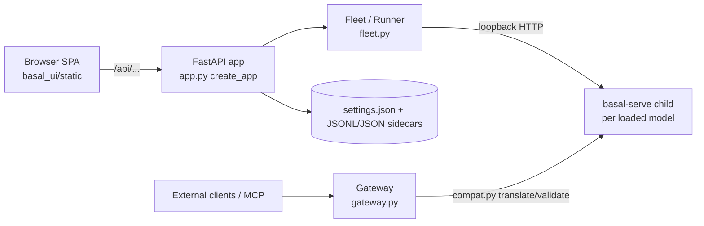

# Repository Guidelines

## Project Overview

basal-ui is a local browser app and API server for the **basal** decision-model Engine (`rkinas/basal`). It assesses host hardware, recommends and downloads models that fit, loads them in private `basal-serve` subprocesses, and provides a playground plus tools for serving, benchmarking, calibration, inspection, and batch inference. It runs on top of the Engine and contains no model code itself (see `docs/adr/0003-separate-repo-on-upstream-engine.md`).

Use the domain terms in `GLOSSARY.md` exactly: Decision, Replay, Engine vs Backend vs Execution mode, Active vs Saved load settings, machine compatibility / model compatibility / memory fit, Inference test, Shipped vs Selected calibration.

## Architecture & Data Flow



- **Entry:** `basal_ui/__main__.py` calls `engine.check()` *before* importing the app, then calls `app.main` (uvicorn).
- **Composition root:** `app.create_app(...)` takes catalog, hardware, fleet, settings, gateway, stats, and history as injectable arguments. Tests rely on this. Add new collaborators the same way; module-level singletons are not used.
- **Model processes:** `fleet.py`: `Runner` wraps one `basal-serve` child bound to loopback on a free port. `Fleet` owns runners, leases them, and forwards Decisions to them.
- **Gateway:** `gateway.py` is a separate Starlette ASGI service for external API traffic. It handles API-key checks, model routing, health/stats, and optional MCP. `compat.py` translates between System One and OpenAI Decisions request/response shapes and their typed errors.
- **Lifespan:** startup auto-loads the remembered model and starts the gateway. Shutdown drains the gateway, stops inspection and the fleet off the app event loop, flushes stats, and removes temporary key state. Keep the loop running while inspection callbacks and model jobs finish.
- **Concurrency:** most code is synchronous and threaded, using explicit locks and generation checks. Async appears only at ASGI/forwarding boundaries. Slow sync route handlers run in FastAPI's threadpool. Background work goes through `jobs.py` (threads, progress, cancellation, in-memory `LogBuffer`).
- **Engine gate:** `basal_ui/engine.py` holds `TESTED_RELEASES`, `SUPPORTED_RANGE`, and `PINNED_RELEASE`, and CI derives its matrix from them. Guard Engine capabilities outside that range with feature probes, not version forks. `BASAL_UI_ENGINE_UNCHECKED=1` bypasses the gate.

## Key Directories

| Path | Purpose |
|---|---|
| `basal_ui/` | Python package. Feature modules: `catalog`, `hardware`, `backends`, `options`, `calibration`, `bench`, `batch`, `inspect`, `auth`, `history`, `stats`, `settings`, `jobs`, `updates` |
| `basal_ui/static/` | Plain HTML/JS/CSS SPA with no build step. Basecoat, fonts, and vendor assets are bundled locally, with no CDN (ADR 0001) |
| `basal_ui/examples/` | Bundled example requests, shipped as package-data |
| `tests/` | Unit tests (`test_ui_<area>.py`, grouped by topic rather than one file per module) |
| `tests/e2e/` | Real-model + Chromium release gate, opt-in |
| `docs/` | `USAGE.md` (product behavior), `API.md` (routes/errors), `BACKENDS.md`, `E2E.md`, `WHATS_NEW.md` (changelog), `adr/`, `research/` (Engine proposals, `TEMPLATE.md`) |
| `scripts/screenshots.py` | Regenerates `docs/images/` screenshots and the tour GIF |

## Development Commands

Run `make install` first. Every other target uses `uv run --no-sync`, so it does not install anything.

```sh
make install                 # uv sync --group dev --extra mcp (pins Engine via [tool.uv.sources])
make run ARGS='--help'       # $PYTHON -m basal_ui (PYTHON defaults to `uv run --no-sync python`)
make lint                    # ruff check . && ruff format --check .
make format                  # ruff format .
make test                    # unit tests with a coverage report, excludes tests/e2e
make test ARGS='tests/test_ui_gateway.py::test_name -x'
make e2e                     # BASAL_E2E=1, real models + Chromium (docs/E2E.md)
make engine REF=v2.4.1       # switch Engine: v* tag → upstream archive; branch/SHA → fork
make engine-pin              # print PINNED_RELEASE
make screenshots             # needs e2e extra, Chromium, ffmpeg, Remek/basal-2.0-mini on disk
```

After `make engine`, running `make install` restores the pinned Engine.

## Code Conventions & Common Patterns

- **Python:** 3.10+, 120-column lines. Ruff lints `F,I,B,UP,SIM` (`B008` ignored for FastAPI `Body(...)`) and `ruff format` is the formatter; `make lint` checks both, `make format` applies the formatter. No type checker is configured. Avoid speculative abstractions (`CONTRIBUTING.md`).
- **Data shapes:** API, config, and records are plain dicts. Catalog and model structures are `dataclass`es. Pydantic is not the domain model.
- **Errors:** raise `ValueError`/`RuntimeError` internally and convert them to HTTP errors at route boundaries. Job failures go into job state and logs. Server error text stays in English. Errors the UI must explain also carry a **message code** that the frontend translates.
- **Persistence:** settings live in `~/.config/basal-ui/settings.json`, overridable with `BASAL_UI_CONFIG`. History (JSONL) and stats (JSON, periodic flush, cross-process merge) share the settings thread/OS file lock. Replacements are atomic; History normally appends and only rotates/clears by replacement. Change in-memory History only after persistence succeeds. Stats record/reset share the cross-process lock so post-reset Decisions survive. API-key files store digests and are owner-only; match their configured filename stem literally. Reuse the `settings.py` helpers.
- **Process state:** runners, jobs, downloads, and logs live in process memory. Model weights sit in the HF cache or the configured models directory.
- **Frontend i18n:** write UI strings in English in code and wrap them in `t()`/`tp()`. Add the Polish translation to `basal_ui/static/i18n.js`. The English literal is the key. Language and theme persist in `localStorage`.
- **Static caching:** `/`, `/viz/` and `/static` are served `no-cache` so the frontend and API cannot drift apart; HTML pages also carry `X-Frame-Options: SAMEORIGIN` and `frame-ancestors 'self'` (`page_headers` middleware in `app.py`). Keep this when adding assets.

## Important Files

- `basal_ui/__main__.py`: console entry point (`basal-ui`).
- `basal_ui/app.py`: app factory, routes, lifespan, static mounting, `/viz` (embeds the Engine's inspection app).
- `basal_ui/fleet.py`: `Runner` (one `basal-serve` child), `Fleet` (runners, downloads, logs, jobs, stats/history recording).
- `basal_ui/gateway.py`, `basal_ui/compat.py`: external API and request-shape translation.
- `basal_ui/engine.py`: Engine version gate and pins.
- `basal_ui/settings.py`: config path, locking, atomic writes.
- `basal_ui/static/{index.html,app.js,i18n.js}`: SPA shell, fetch/error helpers, translations.
- `pyproject.toml`: deps, extras (`mcp`, `e2e`), `dev` group, pytest/ruff/uv config (CPU-only torch index on Linux).
- `.github/workflows/ci.yml`: the merge gate, on pushes to and pull requests into `dev`, `stage` and `main` (either direction); its `ci-ok` job aggregates the matrix and is the required status check. `nightly.yml` checks upstream `main` and is non-gating. `publish.yml` releases `v*` tags (cut on `main`) to PyPI and GitHub Releases. Actions are pinned by commit SHA (Node 24 releases); Dependabot bumps them.
- Branches: `dev` (integration; feature PRs target it) → `stage` (release candidate; e2e gate) → `main` (released). Fixes made on `stage` go back with `stage` → `dev`. Branch protection requires a PR with `ci-ok` green on all three, up to date on `stage`/`main`, enforced for admins on `stage`/`main` (`CONTRIBUTING.md`, "Branches and CI"). `CONTRIBUTORS.md` lists contributors.

## Runtime/Tooling Preferences

- Use **uv** for everything: `uv sync`, `uv run`, `uv pip`. `uv.lock` is the source of truth; avoid plain `pip`.
- The Engine is **not** a runtime dependency because the PyPI package named `basal` is unrelated. The dev group installs it from a uv source pin. When the Engine changes, update all of these together: `TESTED_RELEASES`/`SUPPORTED_RANGE`, the uv source pin, the README install command and badge, and the E2E install command (`CONTRIBUTING.md`).
- Frontend: no Node and no bundler. Add vendor assets locally under `static/`.

## Testing & QA

- **Framework:** pytest, with `pythonpath=["."]` so tests can import `tests.*` helpers. `make test` prints a `pytest-cov` report (`--cov=basal_ui`, missing lines); there is no coverage threshold.
- **Unit tests** call Python APIs directly or use FastAPI `TestClient`. Isolation patterns:
  - set `BASAL_UI_CONFIG` to a file under `tmp_path` via `monkeypatch`;
  - build `create_app`/`Fleet` with injected fakes;
  - monkeypatch runner startup, backend probes, catalog lookups, and HTTP calls.
- **`child` fixture** (`tests/conftest.py`): a loopback fake `basal-serve` that records POSTs, returns configurable responses, and can hold requests to test cancellation and concurrency.
- **Gotchas:**
  - `hardware._static` is cached; call `.cache_clear()` around tests that monkeypatch hardware detection.
  - Stateful tests must shut down the fleet explicitly and wait on events, following `tests/test_ui_backends.py` and `tests/test_ui_app.py`.
- **E2E** (`tests/e2e/`, marker `e2e`): skipped unless `BASAL_E2E=1`. Uses real models, real `basal-serve`, and Chromium. Configure with `BASAL_E2E_MODEL`, `BASAL_E2E_SECOND_MODEL`, `BASAL_E2E_BF16_MODEL`, `BASAL_E2E_MODELS_DIR`, `BASAL_E2E_LOAD_TIMEOUT`, `BASAL_E2E_DOWNLOAD=1`. Behavior that needs specific hardware or a real browser belongs here and must skip with a reason when the hardware is missing (ADR 0002).
  - Setup: `uv sync --group dev --extra mcp --extra e2e && uv run --no-sync playwright install chromium`.
  - For setup, exercised regressions and dated hardware/skip evidence, use `docs/E2E.md`; a green unit-only CI run is not the real-model gate.
- **CI** runs Ubuntu/macOS × Python 3.10/3.13 × each `TESTED_RELEASES` entry, executing `ruff check .`, `ruff format --check .` and the unit tests. E2E is not run in CI.
- **PR checklist** (`.github/PULL_REQUEST_TEMPLATE.md`): one topic per PR; a `docs/WHATS_NEW.md` bullet; Engine-range impact; refreshed screenshots for visible UI changes; lint, test, and E2E results.
