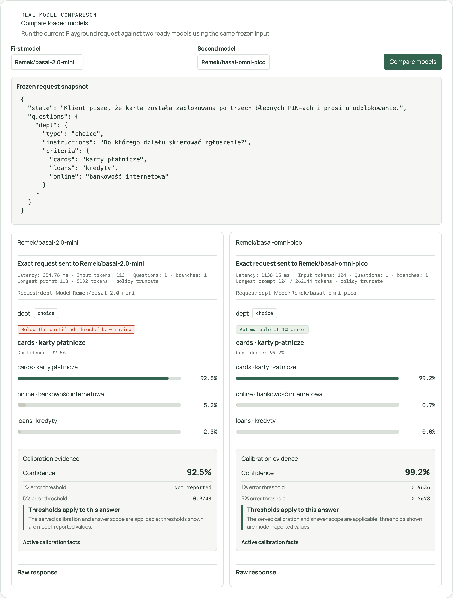
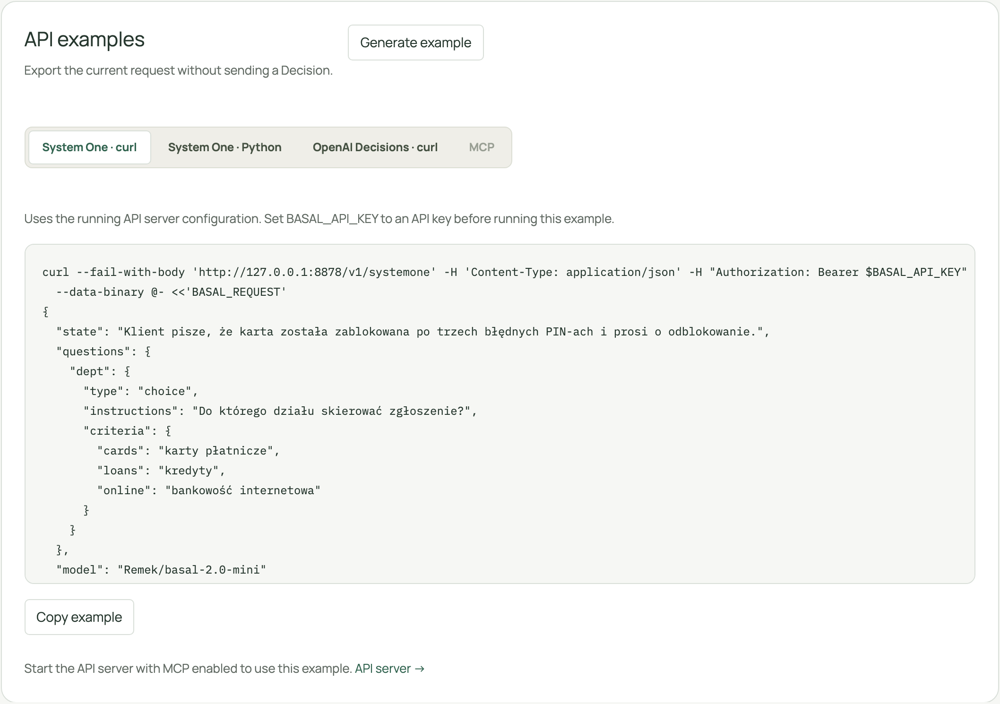
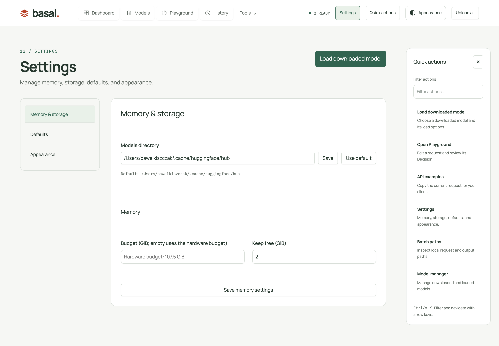
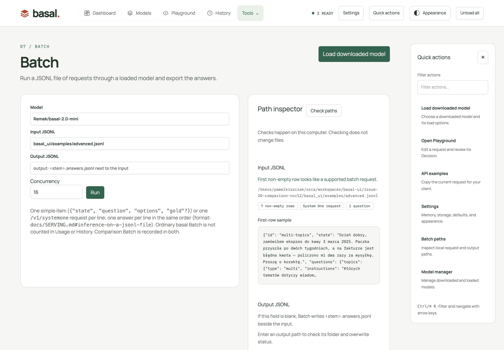

# Browser app: pick a model for your hardware and try it

`basal-ui` is a local web app in the style of LM Studio: it detects the machine, lists every basal model on Hugging
Face with what this machine can do with it, downloads the one you choose, starts `basal-serve` for it and gives you a
playground for decisions. The catalog covers the official `Remek/basal-*` repositories and the community conversions
of `pawelkiszczak` (basal-1.0 GGUF, MLX 8-bit and oMLX oQ6e) and `agentGreg` (basal-1.5-mini MLX 6-bit and bf16),
marked **community**; suggestions use the official ones only. A weights-only GGUF conversion is served with the
tokenizer, prompt format and calibration of its base repository (the model card's `base_model`, pinned to its
`base_model_revision` when the card has one; `--model <base> --gguf <file>`), whose small metadata files are downloaded
with it; one whose card names no base model is listed as not runnable.

## Attached models

On Engine 2.5, **Model manager → Library → Attach a model** downloads a supported base and runs `basal-attach` as a
background job. The curated list currently contains `Qwen/Qwen3-4B`; free-text repository ids are refused. The
result appears in the catalog as an **Attached** model, uses the Engine to serve Decisions, and can be loaded in
eager, mps, mlx, mlx-q8 or fast mode. It is excluded from Suggested and Inspect. Its initial `CALIBRATION.json` has
no certified thresholds, so the Library labels it **uncalibrated** until a Selected calibration is fitted and chosen.
The Calibration tab works on the attached directory as for other models. An Attached model can be removed from
Library only when it is unloaded; only the attachment directory and its links are removed, not the linked base
weights. Engine 2.4.1 hides attachment controls because it has no `basal-attach`.

## Fine-tune

With Engine 2.5 and the `peft` add-on installed, Model manager → Calibration offers **Fine-tune** for downloaded
bf16 basal and Attached models. Select the labelled JSONL, choose an output name and set epochs, learning rate, LoRA
rank/alpha, held-out fraction, maximum prompt length, optional maximum steps and gradient checkpointing. The run is a
cancellable job with logs and reserves twice the model's estimated memory. Its output is placed under
`<models_dir>/adapters/<model-id>/<name>/`; the Load options `adapter` field offers the produced `lora/` directory.
The panel reports held-out top-1 accuracy before and after training; calibrate the merged output on its generated
`heldout.jsonl` before using automated decisions. **Tested on Apple Silicon with basal-omni-pico; other GPUs are
untested.** Engine 2.4.1 hides/refuses this feature.

Install from the [README's source instructions](../README.md#install) until the first PyPI release. From that checkout:

```bash
make run ARGS='--port 7860'           # then open http://127.0.0.1:7860
```

The Engine install takes the extra of the machine (`basal[mlx]`, `basal[gguf]`, `basal[fp8]`, `basal[vllm]`, …).
The UI's separate `mcp` extra enables its API server's MCP endpoint; `make install` includes it.

The Studio layout opens **Dashboard** (`#dashboard`) by default. The top navigation also contains **Models**,
**Playground** and **History**; **Tools** opens **Model manager**, **Hardware**, **Batch**, **Inspect**, **Backends**,
**API server** and **Logs**. **Settings** in the header opens `#settings/storage`, `#settings/defaults` or
`#settings/appearance`; category changes retain unsaved field values. Each view keeps its own hash address, so
bookmarks and browser Back/Forward work. The hardware view retains `#overview`; model log links (`#logs/<model id>`)
still work.

**Quick actions** is a filterable rail beside the workspace on wide screens. Ctrl/⌘+K opens it and focuses its
filter; arrows navigate matching actions, Enter runs one and Escape closes the rail. It opens the downloaded-model
loader, Playground, current-request API examples, Settings, Batch or Model manager; opening a view does not run
inference. The header toggle closes it when more workspace is wanted. On smaller screens it is an inline panel
above the view rather than an overlay covering its controls.

**Dashboard** shows recorded Decision throughput, latency, errors, endpoint traffic and loaded-model activity.
[Recent traffic and lifetime usage have different scopes](#statistics-and-benchmarks); viewing either Dashboard or
Manager does not add requests. **Models** opens Suggested (default) and All models.

**Load downloaded model** in the page header opens the same loader from Dashboard, Playground, Batch, API server,
Manager's panels and the other views. It lists models already on disk, their supported text/media actions and Load
options. Keep it open to see startup, then choose **Use** when ready; the current view's model selector is updated
without navigating away or clearing its input. Inspect lists only its supported bf16 checkpoints. **Browse models
to download** opens Models when the required checkpoint is not on disk.

**Model manager** separates **Library**, **Usage by model**, **Benchmarks** and **Calibration**. Library holds live
inference, loaded models, memory and on-disk variants. Storage configuration is in **Settings → Memory & storage**. Inference updates
every second while Manager is visible: per-model Playground/API/MCP/benchmark requests, longest wait, Engine running
and queued counters, plus batch, benchmark, calibration and backend-test progress. Otherwise it shows *Idle* and the
last Decision time. Loaded-model rows retain state, mode, media, estimated/resident memory, usage, confidence and
Restart / Logs / Unload. Tabs remember the selection; `#manager/library`, `#manager/usage`, `#manager/benchmarks` and
`#manager/calibration` open a specific panel. Load links always open Library.

The header shows readiness and an **Unload** / **Unload all** action when models are loaded. Deleting a model or
revoking a key asks for confirmation, and actions report their outcome in a notification. Navigation wraps on smaller
screens. **ⓘ** on a model opens its card: repository and author (base repository for a conversion), family, tier, port,
size, media, execution mode and why, memory fit, cached revisions, `basal.json`, and the Shipped calibration resolved
for the Active load settings (Saved load settings when unloaded). The card also includes the loaded `GET /v1/models`
entry and README for the selected revision; `basal.json`, the loaded entry and README start collapsed.

**Appearance** keeps both **Green** and **Orange** skins in the header popover, alongside light/dark/system theme
and **EN** / **PL**. Skin and theme are also available in **Settings → Appearance**; all appearance/language choices
are browser-local. The basal mark and semantic success/warning/error colors retain their meaning in both skins.
Coded UI-owned model, option, backend and job messages are translated; uncoded server errors stay English.
Ctrl/⌘+Enter sends the Playground Decision. Existing physical-key shortcuts are preserved: Alt+1 Hardware, 2 Models,
3 Manager, 4 Playground, 5 Batch, 6 Inspect, 7 API server, 8 History, 9 Logs, 0 Backends (Option on macOS, any
keyboard layout); `?` lists them.

**Settings → Defaults** saves **Auto-load remembered models** separately from API-server settings. It restores the
models loaded when basal-ui last ran, in load order. This category also holds update checks and preset import/export.

**Hardware** reports newer basal-ui/Engine releases and newly discovered models. Release checks run at most every
6 hours, or 10 minutes after a failure; an offline on-disk catalog is not treated as newly discovered models.
**Settings → Defaults → Check for updates** disables the release check when switched off.

- **Hardware.** NVIDIA GPU (name, compute capability, memory), Apple Silicon (MLX's recommended working set) or CPU
  (60% of RAM), the engines installed (chips such as `mlx`, `gguf`, `vllm`, `sglang`, `media`), and the memory
  available now (free GPU memory on NVIDIA; free + inactive + speculative pages from `vm_stat` on macOS, which leaves
  out reclaimable file cache; `MemAvailable` on Linux).
- **All models.** Every `Remek/basal-*` repository and each `.gguf` file of a `-GGUF` repository, with weight size,
  estimated memory (weights × 1.2 + 1 GB), fit against the budget and *fit now* against the available memory (*fits*
  up to 85%, *tight* up to 100%), and the `basal-serve` mode it would run in, or why it cannot run here and which
  extra fixes that. Offline, the list uses one complete cached snapshot per repository: `main` when complete,
  otherwise the newest complete snapshot. Partial shards are never combined across revisions; repositories with no
  complete snapshot are omitted.
- **Suggested** excludes community variants and experimental text variants, prefers the current text family and a
  comfortable fit over a tight one, and excludes estimates larger than the hardware budget or available memory now.
  If available memory is unknown, the budget fit stands in for it; unknown estimates remain visibly unknown.
  **Recommendation Backend** defaults to **Automatic**; the alternatives are detected, machine-compatible local
  Backends, not hypothetical installations or external servers. Selecting one recalculates its supported Execution
  modes and memory estimates for Suggested only. All models retains the normal machine-wide assessment.
  *Recommended*: the basal-2.0 family in the machine's preferred format (FP8 on suitable NVIDIA GPUs other than
  data-centre GPUs/the RTX 4090, bf16 there, MLX 8-bit on Apple Silicon, GGUF Q8_0 where available, otherwise bf16),
  4.5B if comfortably fitting, otherwise mini/smallest available. *Best quality* means the largest fitting tier;
  *Fastest* is the mini-tier heuristic, not measured throughput. Use Benchmarks to measure actual performance.
  *Lightest* offers the recurrent pico family. *Multimodal* selects fitting native image/audio checkpoints, including
  when the media add-on is missing; such a card explains the missing dependency and links to Backends instead of
  pretending media can load. Media estimates use their eager/vLLM path, not a text CUDA-graph estimate.
  Loads still enforce the configured Fleet budget, keep-free reserve and existing reservations; recommendations are
  estimates, not a reservation or an Inference test. A selected Backend opens its recommendation's load options for
  review, retaining the Saved revision and other inputs. Leave **Remember** unchecked to load this choice without
  overwriting Saved load settings; check it to save the reviewed options.
- **Download** (a model not on disk yet) fetches only what serving needs (the chosen `.gguf` file of a `-GGUF`
  repository; not the 4.5B's `think/` model) into the models directory and shows the progress in the row; nothing is
  started. Once on disk, Models and its suggestions offer applicable **Load** / **Load with media** actions,
  **⚙ Setup** and **Delete** (a loaded model cannot be deleted). Loading is also available from the shared header
  loader and **Model manager → Library**.
- **⚙ Setup** (Models) opens the load options and saves them for the model without loading it; the next load uses
  them. **⚙ Options** in Model manager and the shared loader opens the same dialog with **Load**.
  Media loads use eager by default; a selected vLLM recommendation or a Saved vLLM mode chooses that path when available.
- **Load** runs `basal-serve` for the model as a subprocess on a free loopback port.
  **Several models can be loaded at once**: each gets its own private `basal-serve`; a loaded model's row shows its
  state and **Unload**, and Models shows a *loaded* chip. A load that would exceed the memory budget is refused (below).
- **Load with media**, for the basal-omni-1.0 bf16 checkpoints (mini and max: images and audio; ultra: images; the
  FP8, GGUF and MLX ports and basal-omni-1.1-max have no encoders): `basal-serve --mode eager --media on`, with
  `--device mps` on Apple Silicon and `--device cpu` on a machine without a GPU, or — with the vLLM Backend selected
  in Suggested or a Saved vLLM mode on an NVIDIA GPU — `--mode vllm --media on`
  ([OMNI.md](https://github.com/rkinas/basal/blob/main/docs/OMNI.md#vllm---mode-vllm)).
  Needs the `basal[media]` extra (pillow, soundfile, scipy, torchvision); the row says so when it is missing.
  **Tools → Backends → Engine add-ons** can install its declared dependencies in the app's virtual environment;
  stop all models/jobs first and restart basal-ui afterward. See [installation safety and limits](BACKENDS.md#installing-engine-add-ons).
  A remembered text-only mode outside eager/vLLM is not applied to a media load.
- **Settings → Memory & storage → Models directory**: the models directory (default: the Hugging Face cache, `HF_HUB_CACHE`) can be set to any
  writable directory; downloads, the downloaded marks, serving and deletes all use it. The setting is kept in
  `~/.config/basal-ui/settings.json` (`BASAL_UI_CONFIG` moves it). The variants on disk are listed with their size and
  **Load**, **Load with media**, **⚙ Options** or **Unload**, or why the variant cannot run here. Deleting is in
  Models: for a `-GGUF` repository only the chosen `.gguf` file goes, and the repository once no `.gguf` is left. The
  directory cannot change while any model is loaded or downloading.
- **Playground**: a model selector (the ready models), the bundled examples (`advanced.jsonl`: one request per
  question type; `media.jsonl`: basal-omni requests with the images and voice clips of `basal_ui/examples/media/` — a
  checkout screenshot whose numbered elements are the options of a `choice` (web agent), a Polish invoice, a revenue
  chart, a Polish complaint call and an English appointment call; `media/make_media.py` regenerates the files), a
  question builder for every type (`choice`, `noul`, `score`, `multi`, `act` with simple costs or a
  cost matrix, `tool`, `classify`, `verify`, `compress`, `extract`, with `max_error` and evidence where the type takes
  them), or the raw JSON request (which carries `"model"`). **Request settings** contains `facts`, `lang`, Edit JSON,
  and supported Thinking / early-exit controls, keeping the model and example selectors visible in the toolbar. Question names must be
  non-blank and unique; requests containing fields or media the builder cannot restore stay visible in Edit JSON mode.
  For `tool` questions, **Import from MCP server** fetches a server's `tools/list`, lets you select definitions, and merges them by name; the source URL is kept with the request while an entered bearer token is used only for the import. **Shortlist to K for this question** ranks the tools against the question's instructions. The Engine recommends at most 50 tools and accepts up to 255. Non-loopback servers use the same SSRF protection as Fetch URL; loopback MCP servers are allowed. [API details](API.md#importing-mcp-tools-and-shortlisting).
  Changing between English and Polish keeps this tab's Playground draft across the page reload; media is not retained
  and must be attached again. **Fetch URL** beside State opens a dialog for a public HTTP(S) address. The app fetches
  anonymously and fills the state for review; it does not send the page until you submit the Decision. HTML is reduced
  to its title, headings, paragraphs, lists and table rows; JSON stays structured and plain text stays text. Responses
  are limited to 4 MiB and extracted text to 200,000 characters. The note below State shows the original and final URL,
  content type, byte count and truncation status; History keeps the source URL and Replay restores it as read-only
  metadata. Unsafe destinations are refused; the exact SSRF policy (including DNS-rebinding protection) is documented in
  [API.md](API.md#fetching-a-url-into-playground-state).
  Choice, multi and non-boolean act options use inline key/description rows with add, remove, move-up/down and
  key-visibility controls. Key-only options are supported; untouched structured descriptions and list-form option
  keys retain their request semantics. Renaming an act outcome keeps its cost-matrix column attached to that outcome.
  Blank or duplicate row keys are reported instead of silently dropping an option. Marked-image options remain
  read-only here and are edited through **Mark elements**.
  Loading or selecting a model, including from another view, retains this tab's attachments and marked-element
  questions. Sending is blocked if the selected model cannot accept the retained media; remove it or select a
  compatible media-loaded model.
  On a model with audio input, **Record** captures a microphone clip; press it again, press Escape, or leave Playground
  to stop. The timer counts down from the 20 MiB attachment limit. The browser must have microphone permission and
  serve the app in a secure context (HTTPS or localhost). Recordings are added as playable WAV attachments.
  Each type has its own
  result view; every answer shows whether it was deferred, whether its confidence clears the model's certified 1% / 5%
  thresholds and how it is calibrated; an answer whose calibration does not hold for it (media answers on a
  text-fitted calibration, `unvalidated` files) gets no automation claim. A truncated state is flagged, and the state
  is shown with evidence spans, kept units and extracted fields marked. A request the builder shows but cannot write
  in its own fields (classify labels with rubrics, keyed criteria, `option_keys`) is sent as it was until that field
  is edited; `multi`, multi-label `classify` and multi `tool` take the set options (objective, threshold, min, max;
  multi and tool also fallback and exclusive keys). Requests go to the selected model's `POST /v1/systemone`. With a
  media server, up to 8 images or audio files (20 MiB each) go along as `media`, with the image `detail`. The media
  examples load their files into the media field, with an audio player for clips; on a model without media they load
  with a notice and cannot be sent. Mark elements on one image to add a `choice` question; a box is drawn with the
  pointer or added with **Add box** and moved or resized with the arrow keys (Shift resizes, Delete removes). Boxes are
  saved as numbered overlays in a marked copy, and their probabilities appear over that image after a decision.
  Saved requests retain the original and marked image and boxes. Evidence spans are disabled while media is attached
  because they refer to spans in the state's text; the raw JSON request still rejects evidence with media. Inspect's
  example list leaves the media examples out (the lens reads text only).

## Playground comparison, API examples and calibration evidence

**Compare loaded models** runs the current request against two different ready models. Both receive the same
frozen state, questions, request settings and ordered attachments, with only `model` changed. Answers are shown
side by side using their actual question types: a choice, an action or a selected set is not replaced by a generic
most-probable label. Each panel retains its request snapshot, warnings, usage and raw response; a failure in one
panel does not hide the other model's answer. Media unsupported by either selected model is refused before sending.
This is an interactive comparison, not an accuracy or performance benchmark. It creates two real Decisions in
History and the existing statistics; merely viewing the panel adds none.



**API examples** uses protocol tabs for System One curl/Python, OpenAI Decisions curl and MCP. **Generate example**
exports the current request without sending inference; editing the request or changing connection configuration
invalidates the old example before it can be copied. System One examples preserve the model, typed fields and
attachment order. They include attachment payloads, so treat copied code as request data. Curl streams JSON through
standard input rather than putting large media in a shell argument.

OpenAI Decisions exports only requests its supported protocol can represent; unsupported fields/types are explained
instead of silently discarded. Use System One for those requests. MCP requires an installed, running MCP-enabled
API server and produces a JSON-RPC `tools/call` for an initialized client. With Engine 2.5.0 it passes the selected
model as the tool's `model` argument. With Engine 2.4.1 the tools take no model and answer with the first loaded
model, so a different selected model is explicitly refused rather than silently routed elsewhere. Examples describe
the running server when present, otherwise the saved endpoint; the API server must be started before execution.
Keyed examples read `BASAL_API_KEY` rather than exposing a stored secret.



Each answer has a **Calibration evidence** rail showing its reported confidence, available certified 1%/5% thresholds,
applicability reason and the active calibration facts exposed by the served model. Missing thresholds stay
**Not reported**. Deferral, media/text scope differences, unvalidated calibration and warnings retain their existing
meaning; the panel introduces no new policy or certification claim. A threshold's applicability is distinct from
clearing it. Rails stack below their content when there is not enough width to remain readable.




## Load options

**⚙ Options** next to every Load button (and **⚙** next to a loaded model's Restart) opens the load options of that
model in collapsible sections (Engine and any section holding a non-default value open; a section you open or close
stays that way for the next dialog in the session; a collapsed section still saves its values):
the **engine mode** (every `basal-serve --mode`, the ones this machine or variant cannot use greyed out with
the reason — CUDA graph modes need an NVIDIA GPU, vLLM / SGLang their extra, MLX Apple Silicon, TPU a TPU VM, Strix
an AMD Strix Halo; Strix and TPU require bf16 Llama-architecture weights, not basal-omni's Gemma or recurrent models.
A ROCm GPU, although PyTorch reports CUDA, is offered none of the NVIDIA-only modes — FP8, NVFP4, vLLM and SGLang;
Ollama and llama-server take the URL of the running service), quantisation, attention kernels,
dtype, the vLLM preset, GPU share and KV-sharing fast prefill, the Gemma 4 eager forward, attention and per-layer
embedding offload (`--eager-forward`, `--eager-attn`, `--ple-offload`), the exit heads directory, determinism, option
orders and the `auto` band, batching, the state and prefix caches, the scheduler and long-request lane, the **prompt
layout** (`--layout canonical`, `state_twice` or `qfirst` for prompt-format-2 models trained on it; default: the
model's basal.json; a non-canonical layout is refused with the state or prefix cache, and a loaded row shows it as a
`layout` chip), the **context
policy** (truncate the middle of the state, or refuse with 422; the share kept from the beginning; `--max-len`), the
CUDA graph engine's kernel switches (`--gemma-attn`, `--merge`, `--lean`, `--tree`, `--batches`, `--readout-layer`,
`--template-prefix`, `--fp8-accum`), `--strict-calibration` and a **revision** (a commit, tag or branch of the
repository: downloaded and served as that snapshot, which calibration and Inspect then read too; a **revision** chip
marks the model in the catalog and on its loaded row). Each field shows only for the modes that read it.

With engine 2.5 the dialog also offers the second read of uncertain answers (`--reread`, `--reread-combine`,
`--reread-max-tokens`, `--reread-image`) and K-order averaging (`--order-average`), the prepared start-up kernels
(`--prepared auto`, `off` or a directory), compile scope and graph memory sizing (`--compile-scope`,
`--graph-memory-gb`, whose value replaces the fixed graph-engine overhead in the fit estimate), the MLX forward and
compute (`--mlx-forward`, `--mlx-compute`), the FP8 / NVFP4 quantisation switches (`--fp8-scaling`,
`--fp8-bf16-layers`, `--quant-load`, `--nvfp4-amax`, `--nvfp4-scope`), state-cache locking and precision
(`--state-cache-lock`, `--state-cache-bits`), the long-request lane for Qwen3.5 models (`--long-lane-gdn`, without
which `--long-lane` is refused for them), rank candidates (`--rank-max-candidates`), vLLM's overlapping engine calls
(`--vllm-overlap`) and the Gemma 4 global attention kernel (`--global-attn`). On engine 2.4.1 each of these is greyed
out with "needs basal engine 2.5.0 or newer", and a saved non-default value is refused with that reason instead of
reaching a basal-serve that would not know the flag; the defaults emit nothing, so a configuration saved on 2.4.1
loads unchanged.

**Presets**
save a set of options under a name to apply to any model; the Playground saves requests the same way (**Saved
requests** in the examples list), and both export to and import from one `presets.json`. In Settings → Defaults, **Import
from URL** fetches and merges a public JSON presets file (up to 1 MiB), using the same validation and merge rules as
file import. Only the values that differ from basal-serve's defaults are passed, and a combination basal-serve refuses
shows its own message on the model's row. **Remember for this model** keeps them for its next plain Load; a restart and
auto-load reuse the options the model runs with. The row lists them as chips. **Experimental**: **Thinking** (`--think auto`, with the reasoning budget, and the Python of an environment
with vLLM or the URL of a running think server when basal-ui's own has no vLLM; the readout-2 calibration, think
weights, LoRA adapter and the think server's vLLM memory, context and log) for basal-2.0 4.5B
([THINKING.md](https://github.com/rkinas/basal/blob/main/docs/THINKING.md)), and the default **early exit** policy of `--mode fast-exit` (basal-1.0 bf16 on CUDA);
both are refused for other models and modes. A model loaded with them gets **Think** (auto / off / force), **Show
reasoning** and **Early exit** in the Playground head, and each answer that thought shows its reasoning tokens and
time, the calibration it used and the confidence it had without thinking.

## Engine integration in 2.3.1

The CPU packed path is available as **mps** with **Device: cpu** (`--mode mps --device cpu`); the default on a
CPU remains eager. For basal-omni on NVIDIA, the default follows the engine: fast on supported sm_120 Blackwell
workstations or Hopper with FlashAttention 3, eager otherwise. Media retains its eager/vLLM paths.

**MLX packed** is off by default. It is available for Llama basal-1.x / basal-2.0 bf16 or MLX models with MLX on
Apple Silicon, without media. It passes `--mlx-packed`; groups whose shared prefix and all suffixes total at most
512 tokens can use packed rows. Longer groups keep the KV-cache path. Static RoPE is required by the engine;
packed arithmetic can change probabilities slightly from the KV-cache path used for shipped calibration.

**Batch rows** exposes `auto` (the engine default), `compact`, `default`, and `fine`. Compact/fine require the CUDA
graph engine. `auto` chooses compact rows where supported, `default` uses padded graphs, and `fine` captures more
shapes at a longer startup cost. Compact rows require compatible attention kernels and additional GPU memory
(about 6 GB extra in upstream RTX 3090 measurements). A kernel-specific refusal appears verbatim on the model row
and in Logs. These settings, MLX packed, device, and the state-cache size survive Remember, Restart, and auto-load.

**State cache (GB)** budgets GPU memory for longest-prefix reuse: growing states reuse their cached beginning;
edits reuse the unchanged prefix and recompute the suffix. This budget competes with weights and graphs; reduce it
if memory is tight. The UI does not report cache hits.

Loaded rows show the child's `/health` running and queued request counters. The UI samples at most once every five
seconds per child with a 0.5-second timeout, without blocking `/api/status`. Missing counters remain null and display
as unavailable; a failed health probe displays unreachable, never idle. These are sampled counts, not live totals.

Playground and Batch distinguish HTTP 422 invalid input, 503 GPU memory exhaustion/service unavailability, and 500
internal errors. The original diagnostic and available request ID are retained. Shorten input or unload another
model after OOM; inspect logs for internal errors. Requests are never automatically retried. Batch output includes
`status`, `code`, and `request_id` on HTTP errors; benchmark logs retain the first diagnostic per HTTP status.

Calibration jobs can **complete with warnings**. The UI shows the engine's actual FIT-label, CERT-confirmation, and
zero-family strict-check warnings from its saved report, also beside the calibration file. A completed job alone
never means certification was confirmed; inspect the report and per-type thresholds. Failed jobs remain failures,
with their log and any report written before failure retained.

## Batch

**Batch** runs `basal-run` from the app: a loaded model, an input JSONL file (simple items or full `/v1/systemone`
requests, [in the engine docs](https://github.com/rkinas/basal/blob/main/docs/SERVING.md#inference-on-a-jsonl-file)), the output file (default `<stem>.answers.jsonl` next to it, e.g. `items.jsonl` → `items.answers.jsonl`), the
concurrency and, for a `--mode fast-exit` model, an early-exit level. On Engine 2.5, **Preset** adds the Engine's
ready questions to state-only JSONL lines, and **Language** selects `auto` (detect from the state), `pl` or `en`.
The progress, the summary (items, errors, seconds, items per second, server p50, accuracy over the items with `gold`)
and the answers page by page are shown; **Download answers** saves the output file. Manual Batch Decisions are not
counted in the statistics or the history. One batch runs at a time; its log is
**Logs → job:batch**. Engine 2.4.1 keeps these preset controls disabled with the installed-engine reason.

**Batch → Schedules** watches an absolute input folder for matching JSONL files and runs each new or changed file
through the selected ready model. Choose a filename pattern, output folder, concurrency and either an interval in
minutes or a local daily time. Outputs use `<stem>.answers.jsonl`; existing outputs are skipped unless overwrite is
enabled. Preset and language settings follow the manual Batch controls. Schedules can be paused, resumed, edited,
deleted or run immediately; each due scan drains matching files in name order before waiting for the next interval.
Scheduled Decisions are recorded in History and Usage with source `schedule`; Recent traffic attributes them to
`RUN /api/schedules` as scheduled invocations, not HTTP management requests. Run history records the model, duration,
rows, errors, completions and skips. Processed file signatures survive run-history rotation. The model is never loaded
automatically. A daily schedule missed while the app is closed runs after restart only when **Catch up missed daily
run** is enabled. Catch-up can run before today's configured time when a previous daily slot was missed, without
consuming today's later slot. Three consecutive failures pause the schedule until it is resumed or edited.

Schedules remain editable while their model is unloaded; saving never loads it. Select **None** in **Preset** to remove
an earlier preset.

The **Path inspector** rail checks the paths on this computer when **Check paths** is pressed, without writing files
or running inference. Input inspection reports the first non-empty row's JSON/basic request shape, a readable sample
and a bounded non-empty-row count; it does not validate every request in the file. It reads at most 64 MiB/100,000
rows and caps the first row at 1 MiB. Reaching an inspection cap is not a Batch input-size limit, and a prefix that
exhausts the scan is not reported as an empty file.

An explicit output path is checked for its parent directory, apparent writability and existing-file overwrite
warning. An empty output field retains Batch's default path without an overwrite check. Checks are advisory:
files/permissions can change before execution. Editing a path clears its old facts, and late checks cannot replace
the facts for a newer value.




## Inspect

**Inspect** embeds `basal-viz` ([in the engine docs](https://github.com/rkinas/basal/blob/main/docs/SERVING.md#see-how-a-decision-is-made))
for a downloaded bf16 PyTorch checkpoint of basal-1.0, basal-1.5, basal-2.0 or Gemma 4 basal-omni (not the recurrent
basal-omni-pico; the GGUF, FP8 and NVFP4 ports cannot be read layer by layer). With Engine 2.5.0 on Apple Silicon with
`basal[mlx]` it also reads the MLX ports of basal-1.0, basal-1.5 and basal-2.0 (basal-viz `--mode mlx`, the layers of
the MLX engine that serves them); with Engine 2.4.1, on other machines and for MLX ports of basal-omni the Inspect list
shows them disabled with the reason. Gemma 4 basal-omni needs an engine whose basal-viz reads it (Engine 2.5.0,
[rkinas/basal#75](https://github.com/rkinas/basal/pull/75)); on 2.4.1 the Inspect list shows it disabled with that
reason. **Start** loads its own model copy into basal-ui's process (MPS on Apple Silicon, MLX for an MLX port, CUDA on
NVIDIA, else the CPU; its memory is counted in the budget until **Stop**), with
the shipped calibration or one fitted in basal-ui and the model's own option orders or 1 or 2, and the page appears
below. basal-viz reads text only; requests carrying media are refused. **Inspect this decision** in the Playground
sends the current request there (with `facts` and `lang`) and lists what differs from the served decision: other
weights of the same family and tier, the engine, option orders, calibration temperatures, thinking and early exit
(explained at the final layer), task questions left out. A decision of another model or with only task questions is
refused with the reason.

## Memory budget

The budget is the hardware budget shown under Hardware unless set in **Settings → Memory & storage** (at least 1 GiB), and
**Keep free** (default 2 GiB) is held back from it. A load is refused with `409 over memory budget: … loaded + …
needed > …` when the estimates of the models already loaded or loading plus the new model's estimate exceed budget −
keep free; unload a model or raise the budget. The Manager Library bar shows each model's resident memory (summed over the
`basal-serve` process group with `ps`, so engine workers count; on Windows the estimates stand in), the committed
estimates and the memory available now. On Apple Silicon, MLX and MPS allocations live in unified memory and may show
only partly as resident memory; the estimate is what the budget check uses.

Optionally set **Unload idle models after minutes** in **Settings → Memory & storage** (empty means off; minimum 1 minute). A ready model is unloaded after that long without a Decision only when its server reports no running or queued work. Changing the timeout starts a fresh countdown for models already loaded. Batch and other model jobs keep their models loaded while they run. Running Cascades and their members, and Comparison models, are excluded from idle unloading. Idle-unloaded models remain remembered for auto-load at the next start; requests return the existing model-not-loaded error until then. The Library, Dashboard and model log show the reason.

## Statistics and benchmarks

### Dashboard

The 15-minute or one-hour window shows **input tokens processed per second**, not generated output tokens, and
requests/s, request-weighted mean latency, error rate, per-minute traffic and public endpoint attribution. These are
recorded child-inference attempts from Playground, the API server and MCP, not all HTTP traffic: UI polling,
pre-inference authentication/validation rejections, manual Batch, benchmarks and private Inference tests do not contribute.

Recent traffic is in memory in this app process only, starts at observation, and is not restored from lifetime
statistics or merged from other processes. Rates use observed elapsed time rather than inventing a full prior
window. Minute-bucket boundaries are approximate; at most 60 minute buckets are retained. Endpoint p95 is labelled
**sampled** because retained latency samples are bounded. Missing Engine token usage contributes zero, not an estimate.
Failed traffic fetches show an unavailable notice and dashes instead of stale live rates. Missing lifetime statistics
show dashes without disabling valid recent traffic; a failed status poll clears live model activity until recovery.
The [traffic API contract](API.md#recent-decision-traffic) describes fields and sampling limits.

### Lifetime usage

**Model manager → Usage by model** lists the Decisions basal-ui recorded per model: requests, questions, errors,
average best-answer probability (the answer's `confidence`; `set_confidence` for `multi`; the largest probability
for `tool`), lifetime mean latency, p95 over the last 1000 retained latencies, input tokens, last use and question types.
Dashboard's **Model activity** uses these same lifetime counters, not a second recording path. The window totals may
differ by time range, process and the legacy lifetime treatment of pre-inference errors.

These totals live in `<settings stem>.stats.json`, survive restarts and merge across apps sharing that settings file.
A model or global reset affects the shared lifetime totals and clears matching recent traffic in this app process;
another process's in-memory traffic is not cleared. A reset discards older unflushed lifetime counts from other
instances, but Decisions recorded after the reset remain counted.

### Benchmarks

**Model manager → Benchmarks** measures one loaded model at a time: 5 warm-up requests, 30 sequential requests (p50 / p95 / mean
latency) and 120 at concurrency 8 (decisions, questions and input tokens per second, errors). Every item with a `gold`
answer is scored once (accuracy overall and per file). The set is either the bundled examples (44 items in
`basal/examples/`) or your own JSONL file or directory: [BENCHMARK_SETS.md](BENCHMARK_SETS.md). The same block runs
three other measurements, one at a time:

- **Load test**: `basal-loadtest` against the loaded model with your sequential / concurrent counts, concurrency,
  questions per request, synthetic states of about N tokens (with a share of long ones and a seed) and, for a
  `fast-exit` model, an early-exit level.
- **Determinism check**: `basal-loadtest --determinism N`: N requests alone, then the same N mixed with N others; a
  model loaded with **Deterministic** (load options) must return identical probabilities.
- **Compare engine modes**: `basal-bench` in basal-ui's own process for a downloaded model: every chosen mode (the
  ones this machine can run, plus `eager-fp32`, `vllm@deterministic` and `fast-exit@<policy>` where available) is
  loaded, measured (latency with one and both option orders, decisions per second, agreement with the first mode,
  accuracy, load time, memory) and freed in turn. Its memory is counted in the budget while it runs (twice the
  estimate with `eager-fp32`); a mode that fails is listed with its error.

- **Identity gate**: `basal-bench --identity` for a downloaded model, in fp32 or bf16. It uses saved attention, merge,
  lean, tree and Gemma attention settings when non-default; the fast mode must be available for this model and
  machine. Results list each prefix-reuse path's gate and maximum probability delta.
- **Order check** (Engine 2.5): `basal-bench --order-check` measures option-order flips and averaged readouts.
  The result is available only when the installed Engine exposes the check.

The last 20 results per model stay in the stats file and are shown side by side. Benchmark requests are not counted
in the statistics or the history.

## Custom calibration

**Model manager → Calibration** runs `basal-calibrate` for a downloaded model on your labelled requests
([CALIBRATION.md](https://github.com/rkinas/basal/blob/main/docs/CALIBRATION.md#input); the simple `basal-run` items with `gold` work too) at the 1% and / or 5%
`max_error` targets. For decision questions basal-ui starts a temporary `basal-serve --no-calibration` of the model on
loopback (its memory is counted in the budget while it runs), calls `basal-calibrate --url` on it and stops it. Task
questions (`classify`, `verify`, `extract` with `gold`) are certified on the answers as served, so with them
`basal-calibrate` runs the engine in basal-ui's process instead (the model's serving mode and load options; its memory
is reserved in the budget until it ends; Cancel takes effect when it finishes). Every problem of the input is reported
with its line before a model is loaded. The job's output is under **Logs → job:calibrate**. The files go to
`calibrations/<org>--<model>/` next to the settings file, each with its report (`.report.txt`); the table compares them
with the shipped file (decisions per type, certified thresholds of the types and tasks, automation on CERT). Fits use the active load settings layout, or the saved layout when unloaded; the table shows each file’s layout and warns when the Selected calibration differs from those settings.
**Import** copies a file fitted elsewhere (with its report next to it) into the list; one fitted on another model or
revision shows basal-serve's warning. **Use** selects one for the model: basal-ui then starts its `basal-serve` with
`--calibration FILE`, and a loaded model shows **Restart to apply**. **Advanced** passes basal-calibrate's own
controls: `--strict` with a `--reference`, `--min-per-type`, `--min-blend`, `--min-family`, `--min-per-set`,
`--concurrency`, the file to compare with (shipped, none: `--no-calibration`, or a path; a path and a `--reference`
file are checked before the run starts), `--report-only` (the run uses the same engine as a fit, the report opens, no
file is written) and `--save-rows`, which keeps the uncalibrated probabilities next to the file; such a file gets
**Refit**, a `--from-rows` fit on them without loading any model (no load options, no memory check). A refit uses its original calibration file to identify the saved rows’ layout; without it, the rows are treated as canonical. When the Engine cannot accept the required layout flag, the affected fit or refit control explains why it is unavailable.

## History and logs

**History** lists every decision basal-ui answered — from the playground, the API server and MCP — newest first:
time, model, source, a preview of the state, the answer of each question with its confidence, latency and HTTP
status. Filter by model and source, search the state, open a row for the full request and response (its time is a
button, so rows open from the keyboard and keep focus across refreshes), copy the request
or **Replay in Playground** (a converted request in the Playground with its model selected; replay only fills the form).
Media payloads, including nested image/audio payload objects in recorded Decisions-style requests, are replaced by
their size. Replay is blocked with an explanation when an original attachment is missing; redaction is not a promise
that the API accepts every recorded media shape. Ordinary structured context and question descriptions, including
fields named `data`, are preserved. The last 2000 decisions are kept in `<settings stem>.history.jsonl` (owner-only)
next to the settings file. A live-only History view keeps the newest 500 rows. **More** enters older-page browsing:
explicitly loaded pages and their cursor are kept across polls until the view or filters are reset.
**Clear history** empties the file before clearing the live view; a failed write leaves the existing records available.
`GET /api/history?order=asc` returns oldest first for incremental consumers;
`order=desc` remains the default, and `after` cursors outside the retained window return retained records only.

**Logs** shows the output of each `basal-serve` (the last 1000 lines per model, kept after unload for the last 10
unloaded models) and basal-ui's own event log (loads, downloads, readiness, errors, unloads, API server starts and
stops, benchmarks, auto-load decisions). `#logs/<model id>` opens one model's tab (the Manager Library row's **Logs** link);
follow mode keeps the view at the newest line; the text can be copied or downloaded. Logs are kept in memory only.
`GET /api/logs` returns a buffer `generation`; send it back as `generation` with `after` to detect a replaced buffer
and receive its retained lines from the start.

## API server

One port serves every loaded model. The API server runs inside basal-ui and forwards each request to the private
`basal-serve` of the model it names, so every request body must carry `"model"`: `400 MODEL_REQUIRED` without it,
`404 MODEL_NOT_FOUND` for a model that is not loaded (both list the loaded models). `GET /v1/models` lists the ready
models (the basal `models` entries and the OpenAI `data` list), `GET /health` names them, and `GET /metrics` exposes [Prometheus metrics](API.md#prometheus-metrics), and `GET /v1/stats` returns
the statistics above (admin key only when keys are required — that is, basal-ui's own key). Details:
[API.md](API.md#several-models-behind-basal-ui).

| Setting | Default | Effect |
|---|---|---|
| Serve the API | Off | Off, the models answer only basal-ui. On, the API server listens on the configured host and port. |
| Exposure | This computer (`127.0.0.1`) | Local network binds `0.0.0.0`; use this only when remote clients need access. |
| Port | `8000` | TCP port of the API server; valid range is 1024–65535. |
| Require an API key | Off | Requires a named key on every API route except `/health`. Supports `Authorization: Bearer <key>` and `X-API-Key`. |
| Max context length | `4096` | Passed to each vLLM and SGLang `basal-serve` (`512`–`131072`). |
| CORS origins | Empty | Optional allowed browser origins, one per line; `*` allows every origin. |
| Decision log | Empty (off) | Every `basal-serve` appends its decisions (propensity records) to this writable file. |
| MCP at `/mcp` | Off | Adds the MCP streamable-HTTP endpoint when the MCP extra is installed. |

**Security.** The server is loopback-only by default. Local-network exposure is unauthenticated unless **Require an API
key** is enabled; use a key before selecting **Local network**. Keys are generated with the `bsl_` prefix, stored as
SHA-256 hashes in the settings file and keys file, and their plaintext is shown only once when created. Copy it then;
it cannot be retrieved later. Revoking a key rewrites the live keys file and takes effect without a restart. Each
`basal-serve` child listens on loopback only and takes no key: only basal-ui, which starts it and knows its private
port, reaches it. basal-ui's internal admin key is not exposed in the UI. To use `/v1/stats` or `/metrics` with authentication, set `BASAL_UI_ADMIN_KEY` before startup as described in the [Prometheus setup](API.md#prometheus-metrics).

**Restart server** restarts only the API server (instant; the models stay loaded) and applies the saved host, port,
key, CORS and MCP settings; until then the status line shows **Restart to apply**. **Max context length** and
**Decision log** belong to each `basal-serve`: a model loaded before such a change shows **Restart** in its Manager
Library row, which reloads only that model. The app checks the chosen bind port before starting the API server and reports
`port <port> on <host> is in use` if another process owns it.

The **Connect** panel provides copy-ready examples for curl (both `/v1/systemone` and `/v1/decisions`), Python
(httpx), TypeSafe and OpenAI SDKs, LiteLLM's `hosted_vllm` provider, and MCP. HTTP inference examples include the
selected model's `"model"` id; when authentication is disabled they omit API-key headers. MCP configuration is
available only while the API server is running with MCP enabled, and uses its streamable-HTTP `/mcp` endpoint.
With Engine 2.5.0, MCP `decide` and `decide_many` take a `model` argument (`list_models` names the loaded ids) and
answer with the first loaded model without one; with Engine 2.4.1 they always use the **first loaded model**: their
schemas have no model argument or model-listing tool. Use the ordinary HTTP routes when you need named-model routing
on 2.4.1. The Engine's stdio bridge needs `--model` (2.5.0) to reach the gateway, so the UI does not advertise it.
Full request and response shapes, error envelopes and compatibility details are in the [HTTP API reference](API.md).

## Serving models from basal-ui

1. Start basal-ui and load one or more models. In **API server**, turn on **Serve the API**.
2. Choose **This computer** (`127.0.0.1`) for local clients. Choose **Local network** (`0.0.0.0`) only when another
   device must connect; enable **Require an API key** first. An unauthenticated LAN listener is accessible to other
   devices on that network.
3. Set the port (default `8000`). Enable **Require an API key**, then save and click **Restart server**.
4. Under **API keys**, enter a name such as `laptop`, choose **Create key**, and copy the displayed `bsl_...` secret.
   It is shown once; basal-ui cannot display it again.
5. Use **Connect** for a copy-ready client snippet. For example:

   ```python
   import httpx

   r = httpx.post(
       "http://127.0.0.1:8000/v1/systemone",
       headers={"Authorization": "Bearer <copied key>"},
       json={
           "model": "Remek/basal-2.0-mini-MLX-8bit",
           "state": "A user asks for a refund.",
           "questions": {
               "route": {
                   "type": "choice",
                   "instructions": "Which team?",
                   "criteria": {"billing": "Billing", "support": "Support"},
               }
           },
       },
   )
   print(r.json()["answers"]["route"])
   ```

6. To revoke access, choose **Revoke** beside the key and confirm. basal-ui rewrites the key file; the API server
   refuses that key on its next request without a restart.

The default settings file is `~/.config/basal-ui/settings.json`; set `BASAL_UI_CONFIG` to change its path. Next to it,
each running basal-ui writes one key file: `<settings stem>.keys-<pid>.json` (for example, `settings.keys-1234.json`),
the API keys from the settings plus that process's internal admin key, read by the API server. It is owner-only
(`0600`) and holds SHA-256 hashes, never secrets. The `basal-serve` children read no key file at all — loopback and
their private port are their only protection — and the internal key never leaves basal-ui's process. Two basal-ui instances may share one settings
file: a key created or revoked in either is written into every matching live instance's key file, the files of exited
instances are removed, and each instance deletes its own file when it quits.
Filename stems are matched literally, so glob characters such as `[` or `*` in `BASAL_UI_CONFIG` do not prevent
creation or revocation from reaching the running instances.
The statistics (`<stem>.stats.json`) and history (`<stem>.history.jsonl`) live next to it as well; both are written under the settings lock, so two
instances add their counts up and neither rotation drops the other's decisions (each History view shows only the
decisions its own instance answered or found in the file at startup).

**Auto-load.** Enable **Load the models when basal-ui starts** to remember every model that reached ready (an unload
forgets it; quitting basal-ui does not). On startup, basal-ui loads them in their load order and starts the API server
with the current settings; a model that is unknown or cannot run any more is skipped and noted in the Logs view.

**Troubleshooting.**

- **Port in use:** choose another port, save, and restart the server. basal-ui checks the configured bind address
  before starting the API server and reports `port <port> on <host> is in use`.
- **400 MODEL_REQUIRED / 404 MODEL_NOT_FOUND:** add `"model": "<id>"` with an id from `GET /v1/models` (or the
  Manager Library) to the body; the model must be loaded and ready.
- **401 Unauthorized:** check that **Require an API key** is on and send the copied secret as
  `Authorization: Bearer <secret>` (or `X-API-Key: <secret>`). Revoked keys stop working immediately; create a new
  key if the original is lost.
- **409 over memory budget:** unload a model, or raise the budget / lower **Keep free** under **Settings → Memory & storage**.
- **CORS preflight returns 400:** add the browser page's exact origin (scheme and host, with any port) to **CORS
  origins**, save, then restart the server. A foreign origin is rejected without an allow-origin header, and a browser
  request (not a preflight) from it is refused with 403 `ORIGIN_REFUSED` before the key check, so a web page cannot
  drive even a keyless server.
- **MCP extra missing:** install `basal-ui[mcp]` in the same environment, then enable MCP and restart the
  server. The UI reports when the extra is unavailable.
- **Settings file is not valid JSON:** the app still opens and shows the settings as empty, but every change is
  refused with the file's path; fix or delete the file by hand, then change settings again.

For API routes, request and response formats, authentication details and compatibility notes, see the
[HTTP API reference](API.md). The Connect panel also includes TypeSafe, OpenAI, LiteLLM and MCP examples.

The browser app binds `127.0.0.1` by default and refuses changes (load, delete, settings) sent from other web origins,
so a web page cannot drive it through the browser; `--host 0.0.0.0` lifts the host check and prints a warning.
Machine-compatibility rules have fixture coverage. Real-model/browser verification and its hardware limits are
recorded in the [verified development gate](E2E.md#verified-dev-gate-2026-10-29).
## Cascades

With Engine 2.5, a Cascade combines ready basal models behind one name. In Model manager → Library, create an
escalation Cascade to retry uncertain decisions at the next loaded model, or a Blend to average probabilities using
positive weights. A Cascade may optionally send remaining uncertain choice questions to an OpenAI-compatible chat
endpoint. Its fallback API key is stored in the owner-only `decision_servers.json` file and is not returned by the API.

Start and stop Cascades from the loaded-model list. They do not load their members, count against the memory budget,
or start automatically after a restart; every member must already be ready. Unloading a member stops any Cascade
that uses it. The Playground reports which level/model answered. Blend and fallback results are marked uncalibrated
and must not be treated as automatable. Cascades are excluded from Calibration, Inspect, and Benchmarks; only
escalation Cascades are available to Batch. Engine 2.4.1 hides this feature.

## Comparison models

In Settings → Decision servers, add a System One server URL, a display name and (when required) its API key. The app
lists models reported by `/v1/models`; a stopped or unreachable server is marked **unavailable** and checked again
automatically. Loopback servers need no consent. Other hosts require checking the consent box because Playground and
Batch request data is sent to that host. Keys are stored in the owner-only `decision_servers.json` beside the settings
file and are never returned by the management API. Delete the server to remove its models and key.

Choose a Comparison model in the Playground's second slot to see both answers and their latencies. Its confidence is
not calibrated, and it is never presented as automatable. Comparison models can also run Batch against labelled
JSONL. Requests using basal-only question types or fields are refused before they are sent; Batch checks every input
line before starting. Media is refused unless the reported model accepts images (audio is not supported).
Comparison models are not loaded processes: they do not count against the memory budget and cannot be restarted or
served through basal-ui's API server or MCP. They do not appear in Load, Calibration, Inspect or Benchmarks.
